<picture>
  <source media="(prefers-color-scheme: dark)" srcset="./assets/header-dark.svg">
  <source media="(prefers-color-scheme: light)" srcset="./assets/header-light.svg">
  
</picture>

 

I'm an ML engineer in the UAE. I train small language models from scratch and build the agent systems around them, usually with one eye on how they break.

Open to ML engineering roles and research collaborations.

<samp>
  <a href="mailto:imranowaisofficial@gmail.com">email</a> ·
  <a href="https://www.linkedin.com/in/owais-imran-497681282/">linkedin</a> ·
  <a href="https://wa.me/971522263081">whatsapp</a>
</samp>

## Things I've built

- **TinyLM**: a 13M-parameter language model on my own architecture, built for story writing. Pre-trained on TinyStories and conversational data, then fine-tuned on SmolTalk for dialogue.
- **[PyRust](https://github.com/shotgun84/pyrust)**: rename `script.py` to `script.pyr` and the parts that can compile run as native code through Rust, up to 80x faster. No decorators, no type annotations, no new syntax.
- **The Expert**: an agentic red-team tester. Point it at an endpoint and it runs hundreds of iterative tests, then writes up the bugs and vulnerabilities it found.
- **[GeoSentinel](https://github.com/shotgun84/Geosentinel)**: a 3D globe of live natural disasters, pulling earthquakes, wildfires, storms and alerts from NASA EONET, USGS and GDACS.
- **QuantMonitor**: a stock research engine. Subagents handle deep research, technical analysis and sentiment, and it returns one investment report for the ticker you give it.

## Before this

At KaiDubai (Jun 2025 to Jan 2026) I built an AI voice agent that cold-called and qualified leads, running on ElevenLabs and OpenAI models.

## What I work in

Mostly Python and PyTorch. TypeScript, React and FastAPI when a model needs a product around it.
